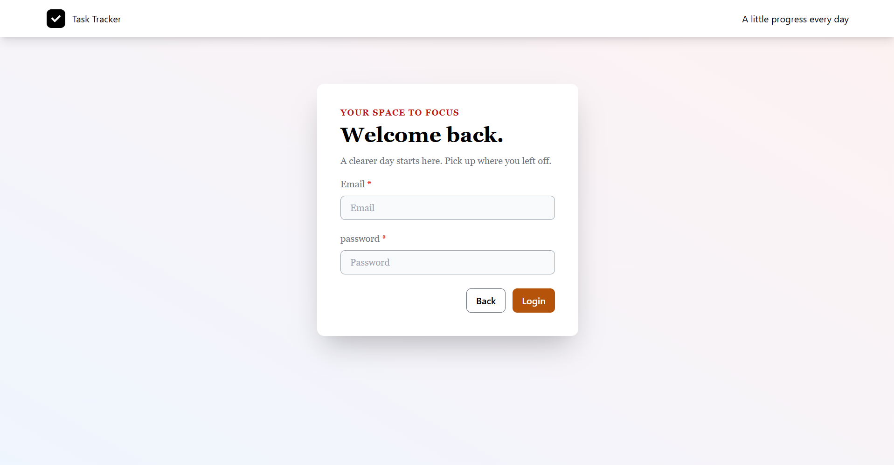
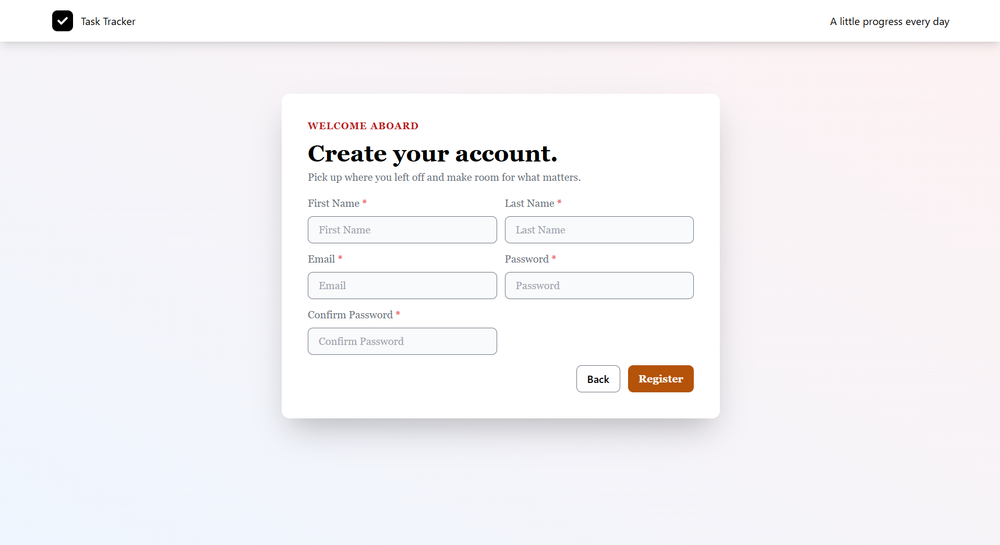
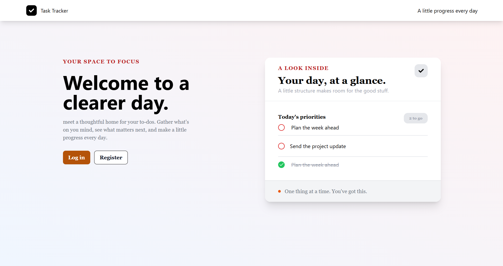
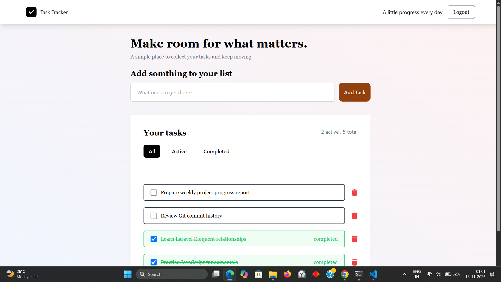

# Task Tracker – Frontend

A responsive full-stack Task Tracker application built with **React.js** and **Tailwind CSS**. It allows users to register, log in, create and manage personal tasks, track their completion status, and organize their daily activities through a clean and interactive interface.

## Live Demo

🌐 **Application:** [Task Tracker – Live](https://task-tracker-frontend-pearl-eta.vercel.app/)

🎥 **Video Demonstration:** Coming soon

## Screenshots

Screenshots of the application will be added here.

| Login Page | Registration Page |
|---|---|
|  |  |

| Home | Dashboard |
|---|---|
|  |  |

## Features

- **User Registration:** Create a new account.
- **User Authentication:** Secure login and logout functionality.
- **Task Creation:** Add new tasks to your personal task list.
- **Task Management:** Update and delete existing tasks.
- **Task Completion:** Mark tasks as completed or pending.
- **Task Filtering:** Organize tasks by all, pending, and completed status.
- **Responsive Design:** User-friendly interface across different screen sizes.
- **API Integration:** Communicates with the Laravel backend using Axios.

## Technologies Used

| Technology | Purpose |
|---|---|
| React.js 19 | Frontend library |
| JavaScript | Application logic |
| Tailwind CSS | Styling |
| Axios | HTTP requests and API integration |
| React Router DOM | Client-side routing |
| Motion | UI animations |
| React Icons | Icons |

## Backend Repository

The frontend communicates with a Laravel REST API.

🔗 **Backend GitHub:** [Task Tracker – Backend](https://github.com/Amal-Francis/task-Tracker-backend)

**Backend Technologies:**
- PHP
- Laravel 12
- Laravel Sanctum
- MySQL (local development)
- Neon PostgreSQL (production database)

## Getting Started

Follow these steps to run the frontend application locally.

### Prerequisites

Make sure you have installed:

- Node.js and npm
- Git
- A running instance of the Task Tracker backend

### 1. Clone the repository

```bash
git clone https://github.com/Amal-Francis/task-tracker-frontend.git
```

### 2. Navigate to the project directory

```bash
cd task-tracker-frontend
```

### 3. Install dependencies

```bash
npm install
```

### 4. Configure the backend API URL

Configure the Axios API base URL in the frontend to point to your locally running Laravel backend.

For local development, the backend runs at:

```text
http://localhost:8000
```

For production, use your deployed backend URL:

```text
https://task-tracker-backend-rrol.onrender.com
```

### 5. Start the development server

```bash
npm start
```

The application will be available at:

```text
http://localhost:3000
```

## Deployment

The application is deployed using:

- **Frontend:** Vercel
- **Backend:** Render
- **Production Database:** Neon PostgreSQL

## Project Structure

```text
task-tracker-frontend/
│
├── public/
├── src/
│   ├── components/
│   ├── pages/
│   ├── ...
│   └── App.js
│
├── package.json
├── tailwind.config.js
├── postcss.config.js
└── README.md
```

*The structure above provides a simplified overview. Refer to the source code for the complete project structure.*

## Author

**Amal Francis**

- GitHub: [Amal-Francis](https://github.com/Amal-Francis)
- Frontend Repository: [task-tracker-frontend](https://github.com/Amal-Francis/task-tracker-frontend)
- Backend Repository: [task-Tracker-backend](https://github.com/Amal-Francis/task-Tracker-backend)

---

⭐ If you find this project useful, feel free to explore the repository!
